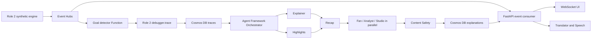

# Root Cause

**Every goal has a bug.** When a goal goes in, Root Cause rewinds the play, finds the
defensive mistakes behind it, proves which one mattered most with 200 counterfactual replays,
and has a team of Microsoft Agent Framework agents explain it, with every sentence cited, to a
fan, an analyst or a TV studio, in English, Hindi or Spanish.

## For judges

- **Live demo:** <https://harshjha15335.github.io/RootCause/>. No login, install or backend
  needed; it runs in any modern desktop or mobile browser.
- **Demo video (under 2 minutes):** _add the public YouTube/Vimeo link here_.
- **Try it:** open **Match library** on the home page and pick a match. Goals marked in yellow
  are traced. Open one in **Goal Autopsy** (for example
  [goal 3 of the 4-4 match](https://harshjha15335.github.io/RootCause/?goal=wlb-msb-2023-11-12-g3#/autopsy)),
  step through the beats to **Verdict**, then switch Fan / Analyst / Studio, Simple / Expert and
  the language. **Tactics Lab** (`#/lab`) shows full-match tracking, the broadcast HUD and
  My Club / My Player personalization. Press `?` for keyboard shortcuts.

**What the public demo runs live and what it replays.** The website is static. It replays
matches, traces, explanations and overlays that the real engine, Debugger and backend
exported (`web/tools/export_*.py`). The explanations shown are the cited, evidence-only
fallback (`status: pending`), not live model output, because no Azure subscription was
available to the team. The live path (Event Hubs → Function → Debugger → Agent Framework
graph on Foundry → Content Safety → WebSocket UI) is implemented, tested with mocks and
defined in Bicep, but has not been deployed. See [validation status](docs/VALIDATION.md).

| Hackathon stage | Where it happens |
| --- | --- |
| Ingest synthetic events | `engine/` match simulator, `functions/goal_detector`, `api/` WebSocket `/live/{id}` |
| Interpret into statistics | `web/tools/export_analysis.py` (xG, passing, heatmaps, momentum), Tactics Lab |
| Explain why it matters | `debugger/` causal chain and counterfactual blame, `agents/` Explainer → Recap |
| Render for broadcast | timed `overlays.json`, Highlights agent clip windows, 3D Autopsy replay |
| Personalize | Persona agent (Fan / Analyst / Studio), My Club, My Player focus, en / hi / es |

**Measured accuracy.** On 99 planted goals the Debugger names the planted player and mistake
first 30% of the time overall and 81% of the time for LATE_STEP_UP, the one mistake type it
has a detector for so far ([eval/report.md](eval/report.md)).

**Microsoft technology.** Runs today: the Microsoft Agent Framework workflow
(`agents/orchestrator.py`) that produced every explanation, highlight list and recap in the demo,
with evidence-only agents in place of model calls, and GitHub Actions CI. Written and tested
with mocks but not yet run against a live service: Microsoft Foundry model deployments and
`azure-ai-evaluation`, Azure Functions, Event Hubs, Cosmos DB, Container Apps, Container
Registry, Key Vault, Application Insights, AI Content Safety, Translator, Speech, Entra ID auth,
and the Bicep/`azd` deployment.

## Team build notes

Role 3 implementation for the Agents & Cloud Lead brief: FastAPI/WebSockets, Microsoft Agent
Framework orchestration, Azure adapters, deployment infrastructure, and evaluation tooling.
All demo clubs/players/data are synthetic.

## Run locally

Python 3.12+, Node 24, and `uv` are required. No cloud account or credentials are needed:

```sh
uv venv .venv --python python3.12
uv pip sync --python .venv/bin/python --require-hashes requirements.txt
npm ci --prefix frontend --ignore-scripts
.venv/bin/python -m pytest -q
.venv/bin/ruff check .
.venv/bin/pyright
npm run lint --prefix frontend
.venv/bin/python -m uvicorn api.main:app --host 127.0.0.1 --port 8000
```

In a second terminal, run `.venv/bin/python scripts/smoke.py` for a real HTTP/WebSocket
match → goal → trace → explanation → highlights → report check. `POST /matches` with
`{"seed":42}` starts a four-event seeded replay. Connect to `/live/{id}` to receive all
retained messages followed by live updates. Clients deduplicate by match ID and sequence.

In the Codex cloud workspace, `bash scripts/setup.sh` refreshes the frozen dependencies,
checks the backend/frontend, and stages the Function. `bash scripts/cloud-tools.sh`
installs the pinned Azure CLI, azd and Bicep tools without logging in or creating resources.
Source `scripts/activate-tools.sh` in each new terminal before using cloud tools.

## Architecture



The procedural Orchestrator starts an actual Microsoft Agent Framework graph. Explainer
and Highlights run concurrently with evidence-only tools. Explainer plans one paragraph
per causal link and the Debugger's root summary; Highlights selects clip windows and
cited captions. Recap waits for both outputs before composing the goal story. Persona
has no tools and produces Fan, Analyst and Studio presentations concurrently.

Every output sentence has evidence IDs in its structured data and displayed text. To
prevent invented numerical or causal facts, the Explainer assembles tool-supplied, cited fact sentences into paragraphs; other
models return structured plans. The server validates the actual prose before display. Arbitrary model-written speeches are not
accepted. The validator checks sentence text, citation ownership and root wording, not
just IDs. The root is the largest counterfactual goal-rate drop; models cannot change it.

The model Explainer receives a 15-second attempt timeout and one retry, within a 20-second
overall graph budget. Exhaustion returns cited templates with status=pending and preserves
all trace/blame data. Highlights failure uses chain-link clip order; Recap/Persona failures
retain factual templates. 429 backoff switches to the light deployment. Content Safety
checks all explanation, caption and recap prose; flags trigger a constrained light-model
neutral rewrite, while safety outages withhold prose. Translation falls back atomically
to explicitly labeled English and disables voice. Speech failure returns 503.

## Cloud integration

[Deployment instructions](docs/DEPLOYMENT.md) cover `azd up`, identity, quota, costs,
GitHub federation and live validation. Bicep defines Foundry/project/model deployments,
Event Hubs/groups, Cosmos/four containers (goals, traces, explanations, agent_steps), the Function, two Container Apps, ACR,
Key Vault, Application Insights/Log Analytics and an 80% budget alert. Managed identities
and RBAC replace resource connection-string secrets. Key Vault is provisioned for any
future third-party credentials; current Azure adapters do not require stored keys.

Azure mode uses Event Hubs for demo events. Its recorded fixture envelope is explicitly
labeled `synthetic-fixture`; the Function persists that supplied fixture. External engine
publishers send raw match events and the Function calls the real `DEBUGGER_MODULE.trace()`.
Both paths share Cosmos and the API worker. Durable leases, event markers, and stored
messages support retries and restart recovery. Deploy one API replica/worker: the broker
has one active owner; a distributed multi-replica fanout layer is not implemented.

Local mode uses volatile memory and evidence-only agents. The replay's counterfactual
numbers/causal chain are fixed sample data, not a simulation or measured accuracy result.
Only positions vary with seed. The lightweight backend demo uses fixed evidence. The separate
Role 2 engine and Debugger are included in `engine/` and `debugger/`. Their adapter is
`debugger.plugin`; its integration with the explanation contract passes the combined tests. A direct
`POST /ingest/evidence` route supports recorded traces when Event Hubs is unavailable.

Azure API routes require v2 Entra delegated access tokens with the Root Cause scope;
health/storage-readiness probes are anonymous. The integration console is a small test
client, not Role 1's finished match/root-cause UI. Backend CORS is restricted to its
configured frontend. Demo limits bound match creation; in-memory history is not intended
for long-lived production datasets. Complete end-to-end restart transactions, retention,
operational load testing, and multi-replica delivery need further hardening before production.

## Evaluation and validation

```sh
.venv/bin/python eval/agents_eval.py samples/evaluation.jsonl --output /tmp/fixture.evaluation.json
```

The runner rejects zero cases, checks every rendered sentence and its citations, evaluates the root against
supplied ground truth, records latency, and separates fixtures from engine datasets.
Fixture runs do **not** produce an engine accuracy headline. Supply Role 2's planted-goal
JSONL dataset for the 100-goal accuracy evaluation. Every evaluated case inspects the actual displayed paragraphs, root summary, captions
and mode recaps. Unsupported wording or a wrong citation lowers sentence_groundedness;
root_wording_accuracy compares the summary with the Debugger's first link. `--foundry`
runs live model agents and submits automatically generated sentence/context rows to
`azure-ai-evaluation` in Foundry. Set FOUNDRY_PROJECT_ENDPOINT and EVALUATION_MODEL_ENDPOINT;
no separate hand-written groundedness dataset is used.
See [validation status](docs/VALIDATION.md) for measured local results and unrun cloud checks.

Local validation: 81 tests pass, including real engine-to-explanation integration and model failure recovery. The single synthetic fixture scores 1.0 for actual
sentence grounding using the pending evidence-only fallback. Engine root-cause accuracy is
measured on planted goals ([eval/report.md](eval/report.md)); live Foundry groundedness remains
unmeasured until Azure access is available.

Application Insights receives workflow/model spans, goal/match IDs, timing and returned
token usage. Sensitive prompt/evidence content tracing stays disabled. Token prices are
not hardcoded; use deployment pricing and exported token usage for monetary cost analysis.

GitHub Actions checks tests, Ruff, Pyright, ESLint, functional smoke, secrets, Bicep and
container builds. Deployment follows successful main-branch CI using OIDC and a production
environment. Remote deployment requires repository variables and federation to be configured.
Local checks do not establish that hosted GitHub Actions or Azure deployment succeeded. GitHub Copilot usage is not
claimed: the PDF's VS Code Copilot requirement must be completed and documented by a
team member using that tool.

## Docker

Standard builds use `docker build -t rootcause-api .` and
`docker build -t rootcause-frontend frontend`. In the onboarding machine Docker's build
network cannot resolve package/proxy hosts. The verified offline alternative is:

```sh
python -m pip download --only-binary=:all: --require-hashes --dest /workspace/rootcause-dev/wheels -r requirements.txt
docker build --build-context wheelhouse=/workspace/rootcause-dev/wheels --build-arg ROOTCAUSE_DEPENDENCY_STAGE=offline-dependencies -t rootcause-api .
```

Both installation paths check the same lockfile hashes. Containers run without root.

See [docs/SPEC.md](docs/SPEC.md) and [samples](samples) for the proposed team contracts.
They remain provisional until the UI and engine owners agree on them.

## Engine & Debugger (Role 2)

The truth layer: a seeded synthetic match engine, planted mistakes with ground truth, and a
Debugger that assigns blame by counterfactual replay. Plain Python + NumPy, no language models.
Formats and the mapping onto `docs/SPEC.md`: [`docs/ENGINE.md`](docs/ENGINE.md). Every tunable
number: [`config/weights.yaml`](config/weights.yaml).

```bash
python -m engine.simulate --seed 7                                   # one match -> matches/
python -m engine.mistakes --bug LATE_STEP_UP --player H3 --minute 30 --seed 7
python -m engine.stream matches/m-0007.events.jsonl --ws --speed 10  # ws://localhost:8765
```

**Backend integration.** `debugger.plugin.trace(event_dict)` takes a team-contract goal event and
returns a team-contract `Evidence` with `source="debugger"` (tested against `api/ingestion.py` in
`tests/test_plugin.py`). The combined tests and Function packaging pass; the real-goal
ingestion configuration is `DEBUGGER_MODULE=debugger.plugin`. Setting this variable alone does
**not** replace the `/matches` fixture generator with a real engine stream. Matches are rebuilt from
their ID: `m-0007` is a free match with seed 7, `p-1012` has one planted mistake.
`debugger.plugin.team_events(match_id)` returns a match's converted events for publishing; do not
publish raw `engine.stream` JSON to the backend.

**Match engine.** A second-by-second state machine. Players move toward formation slots that shift
with the ball; the back four hold a line, man-mark near their own goal and press; offside is
enforced. The ball carrier duels, holds, shoots (more eagerly the better the chance), passes,
crosses or carries. Same seed, same match; any second can be snapshotted and resumed exactly.
Realism targets checked by `tests/test_realism.py`: 2,000–3,000 events, 75–85% pass accuracy,
20–28 shots, 1–3.5 total xG per match.

**Goal probability.** `1 / (1 + exp(-(w0 + w1·angle − w2·distance − w3·blockers − w4·pressure)))`.

**Planted mistakes.** `engine/mistakes.py` forces a known mistake (late step-up, duel lost, press
missed, marking lost, cross not blocked) during a dangerous attack. It keeps the mistake only if
that attack scores and the same attack with the same randomness but without the mistake does not
(a "but-for" test), so every planted goal really was caused by its mistake. The Debugger never sees
the ground truth.

**Counterfactual blame.** For one goal:
1. Walk back through the possession (up to 25 s) and detect mistakes from the bug catalogue.
2. Replay the attack 200 times from one second before the earliest link, using Pearl's three steps:
   - **Abduction.** The attackers' runs and actions are replayed exactly. An action that succeeded
     with probability p succeeds again with probability p_new / p, where p_new is the engine's
     formula against the replayed defence.
   - **Action.** Fix one mistake.
   - **Prediction.** Re-simulate the defenders. The mean is the chance the goal still happens.
3. Each replay either scores or not, so every number is an actual count out of 200 (e.g. 140 with
   nothing fixed, 20 with the late step-up fixed). Blame = that link's drop in goals ÷ the sum of
   drops, computed from the same counts. The biggest share is the root cause.

**Accuracy and limitations.** `python -m eval.accuracy --matches 100 --seed 1000` plants one
goal-causing mistake (random bug type, player and minute) in each match and checks whether the
Debugger names that player and bug first. Measured on 99 planted goals (one seed failed to plant):

| Planted bug | Goals | Top-1 | Innocent player blamed first | Abstained |
| --- | --- | --- | --- | --- |
| LATE_STEP_UP | 37 | 81% | 14% | 5% |
| MARKING_LOST | 39 | 0% | 69% | 23% |
| PRESS_MISSED | 16 | 0% | 31% | 56% |
| CROSS_NOT_BLOCKED | 4 | 0% | 50% | 50% |
| DUEL_LOST | 3 | 0% | 67% | 33% |
| **All** | **99** | **30%** | **41%** | **23%** |

A separate 50-goal run planting only LATE_STEP_UP (`--seed 2000 --bug LATE_STEP_UP`) gives 70%
top-1 and 82% top-3. Only the LATE_STEP_UP detector exists so far, so the other four types cannot
score a top-1 hit; fixes exist for all five. Full results: [eval/report.md](eval/report.md),
[eval/report.LATE_STEP_UP.md](eval/report.LATE_STEP_UP.md) and the per-case JSON beside them. The Fabric exporter and an Event Hubs producer for the engine are
placeholders. Keep measured results separate: local fixture sentence grounding
(`eval/agents_eval.py`) is not engine root-cause accuracy, and neither proves live Foundry or Azure
deployment.
