# Root Cause

**Every goal has a bug.** Role 3 implementation for the Agents & Cloud Lead brief:
FastAPI/WebSockets, Microsoft Agent Framework orchestration, Azure adapters, deployment
infrastructure, and evaluation tooling. All demo clubs/players/data are synthetic.

## Run locally

Python 3.12+, Node 24, and `uv` are required. No cloud account or credentials are needed:

```sh
uv venv .venv --python python3.12
uv pip sync --python .venv/bin/python --require-hashes requirements.txt
npm ci --prefix frontend --ignore-scripts
.venv/bin/python -m pytest -q
.venv/bin/ruff check .
.venv/bin/pyright
npm run lint --prefix frontend
.venv/bin/python -m uvicorn api.main:app --host 127.0.0.1 --port 8000
```

In a second terminal, run `.venv/bin/python scripts/smoke.py` for a real HTTP/WebSocket
match → goal → trace → testimony → verdict → report check. `POST /matches` with
`{"seed":42}` starts a four-event seeded replay. Connect to `/live/{id}` to receive all
retained messages followed by live updates. Clients deduplicate by match ID and sequence.

In the Codex cloud workspace, `bash scripts/setup.sh` refreshes the frozen dependencies,
checks the backend/frontend, and stages the Function. `bash scripts/cloud-tools.sh`
installs the pinned Azure CLI, azd and Bicep tools without logging in or creating resources.
Source `scripts/activate-tools.sh` in each new terminal before using cloud tools.

## Architecture

```mermaid
flowchart LR
  Engine[Role 2 synthetic engine] --> EH[Event Hubs]
  EH --> Function[Goal detector Function]
  Function --> Debugger[Role 2 debugger.trace]
  Debugger --> Cosmos[Cosmos DB traces]
  EH --> API[FastAPI event consumer]
  Cosmos --> Workflow[Agent Framework graph]
  Workflow --> Orchestrator[Orchestrator]
  Orchestrator --> Players[Player agents in parallel]
  Players --> Judge[Judge and one rebuttal round]
  Judge --> Recap[Recap and Persona in parallel]
  Recap --> Safety[Content Safety]
  Safety --> Verdicts[Cosmos DB verdicts]
  Verdicts --> API
  API --> WS[WebSocket UI]
  API --> Translator[Translator and Speech]
```



The Orchestrator reads evidence and selects at most three implicated players. Player
agents receive only their bound `my_link`/`my_view` tools. The Judge has full evidence
and a claim-checking tool. The server independently validates each decision, preserves
engine attribution, and permits one rebuttal round. Recap chooses an evidence-backed
story order; Persona selects Fan, Analyst or Studio presentation. A full-time recap agent
plans highlights and cause summaries using only checked match verdicts.

To prevent invented facts, model responses use strict schemas. Numerical claims must
exactly match engine evidence; story plans must reference existing evidence IDs. The
server renders factual prose through audited templates. This implementation deliberately
uses constrained plans rather than unrestricted model-written speeches. No semantic
checker is claimed for arbitrary free-form assertions.

Foundry calls use the actual Agent Framework `Agent` and Foundry project's Entra-authenticated
OpenAI Responses client. The graph is built with `WorkflowBuilder`/executors. Each player
has a 15-second attempt deadline, one retry, and a factual fallback. The graph has a
20-second overall deadline; the final fallback retains the trace and evidence-only ruling.
429 responses back off and try the light deployment. Judge failure preserves engine
blame. Content Safety failure/flags withhold narrative; flags trigger the constrained
light-model neutral rewrite. Translation fails to explicitly labeled English; speech
failure returns 503 and the console disables audio.

## Cloud integration

[Deployment instructions](docs/DEPLOYMENT.md) cover `azd up`, identity, quota, costs,
GitHub federation and live validation. Bicep defines Foundry/project/model deployments,
Event Hubs/groups, Cosmos/four containers, the Function, two Container Apps, ACR,
Key Vault, Application Insights/Log Analytics and an 80% budget alert. Managed identities
and RBAC replace resource connection-string secrets. Key Vault is provisioned for any
future third-party credentials; current Azure adapters do not require stored keys.

Azure mode uses Event Hubs for demo events. Its recorded fixture envelope is explicitly
labeled `synthetic-fixture`; the Function persists that supplied fixture. External engine
publishers send raw match events and the Function calls the real `DEBUGGER_MODULE.trace()`.
Both paths share Cosmos and the API worker. Durable leases, event markers, and stored
messages support retries and restart recovery. Deploy one API replica/worker: the broker
has one active owner; a distributed multi-replica fanout layer is not implemented.

Local mode uses volatile memory and evidence-only agents. The replay's counterfactual
numbers/causal chain are fixed sample data, not a simulation or measured accuracy result.
Only positions vary with seed. Role 2's engine/debugger are **not included**. A direct
`POST /ingest/evidence` route supports recorded traces when Event Hubs is unavailable.

Azure API routes require v2 Entra delegated access tokens with the Root Cause scope;
health/storage-readiness probes are anonymous. The integration console is a small test
client, not Role 1's finished match/courtroom UI. Backend CORS is restricted to its
configured frontend. Demo limits bound match creation; in-memory history is not intended
for long-lived production datasets. Complete end-to-end restart transactions, retention,
operational load testing, and multi-replica delivery need further hardening before production.

## Evaluation and validation

```sh
.venv/bin/python eval/agents_eval.py samples/evaluation.jsonl --output /tmp/fixture.evaluation.json
```

The runner rejects zero cases, checks structured claim grounding, evaluates the root against
supplied ground truth, records latency, and separates fixtures from engine datasets.
Fixture runs do **not** produce an engine accuracy headline. Supply Role 2's planted-goal
JSONL dataset for the 100-goal accuracy evaluation. `--foundry` runs actual model agents;
`--groundedness-data` additionally uses `azure-ai-evaluation` and publishes to Foundry.
See [validation status](docs/VALIDATION.md) for measured local results and unrun cloud checks.

Application Insights receives workflow/model spans, goal/match IDs, timing and returned
token usage. Sensitive prompt/evidence content tracing stays disabled. Token prices are
not hardcoded; use deployment pricing and exported token usage for monetary cost analysis.

GitHub Actions checks tests, Ruff, Pyright, ESLint, functional smoke, secrets, Bicep and
container builds. Deployment follows successful main-branch CI using OIDC and a production
environment. Remote deployment requires repository variables and federation to be configured.
Local checks do not establish that hosted GitHub Actions or Azure deployment succeeded. GitHub Copilot usage is not
claimed: the PDF's VS Code Copilot requirement must be completed and documented by a
team member using that tool.

## Docker

Standard builds use `docker build -t rootcause-api .` and
`docker build -t rootcause-frontend frontend`. In the onboarding machine Docker's build
network cannot resolve package/proxy hosts. The verified offline alternative is:

```sh
python -m pip download --only-binary=:all: --require-hashes --dest /workspace/rootcause-dev/wheels -r requirements.txt
docker build --build-context wheelhouse=/workspace/rootcause-dev/wheels --build-arg ROOTCAUSE_DEPENDENCY_STAGE=offline-dependencies -t rootcause-api .
```

Both installation paths check the same lockfile hashes. Containers run without root.

See [docs/SPEC.md](docs/SPEC.md) and [samples](samples) for the proposed team contracts.
They remain provisional until the UI and engine owners agree on them.
